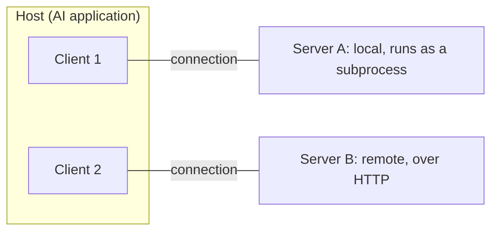

## 01. The question

An AI application is only as useful as what it can reach: files, a database, an issue tracker. Each of those has its own API. Without a shared protocol, every application needs its own integration for every source. Anthropic described the problem this way when it announced MCP on 25 November 2024: each new data source needs its own custom implementation [\[1\]](#ref-1).

The Model Context Protocol (MCP) is an open protocol for that connection. The specification says it takes some inspiration from the Language Server Protocol, which does the same job for programming languages and editors [\[2\]](#ref-2).

MCP is not an AI model and not a context manager. It is a message format. A server says what it can do, and an application asks it to do it.

> Messages marked "measured" are from my own run of a Python server with `mcp` 2.3.0, speaking protocol revision 2026-07-28. Earlier revisions differ, and section 04 lists how.
{: .prompt-info }

## 02. Who talks to whom?

The specification names three roles [\[2\]](#ref-2):

- The **host** is the AI application, such as Claude Code or Claude Desktop.
- A **client** lives inside the host and holds one connection.
- A **server** is a program that provides context and capabilities.

The host creates one client per server [\[3\]](#ref-3).



_One host, two clients, two servers. The roles are from the specification [\[2\]](#ref-2) [\[3\]](#ref-3)._

"Local" and "remote" describe where the server runs. A local server uses the stdio transport and usually serves one client. A remote server uses Streamable HTTP and usually serves many [\[3\]](#ref-3).

## 03. What can a server offer?

Three things. Each has a list method and a method that uses the item.

| Primitive | What it is | Who decides to use it | List | Use |
|---|---|---|---|---|
| Tools | Functions the model can run | The model, with a human able to deny [\[4\]](#ref-4) | `tools/list` | `tools/call` |
| Resources | Data that gives context, identified by a URI | The host application [\[5\]](#ref-5) | `resources/list`, `resources/templates/list` | `resources/read` |
| Prompts | Message templates with arguments | The user, for example as a slash command [\[6\]](#ref-6) | `prompts/list` | `prompts/get` |

_Methods and control model from the 2026-07-28 specification pages for tools, resources and prompts [\[4\]](#ref-4) [\[5\]](#ref-5) [\[6\]](#ref-6)._

A database server could offer a query tool, a resource holding the schema, and a prompt with example questions [\[3\]](#ref-3).

The protocol stops at the server's edge. It does not say how an application uses a model or what goes into the model's prompt [\[3\]](#ref-3). A server does not merge context from other servers or decide what the model sees. The host does that.

## 04. What does a message look like?

Every message is JSON-RPC 2.0 [\[7\]](#ref-7). There are four shapes:

- A request has `jsonrpc`, an `id` (a string or integer, never null), a `method` and optional `params`.
- A result response has the same `id` and a `result` object. In this revision `result` always has a `resultType`, and `"complete"` means the request is finished.
- An error response has the same `id` and an `error` with an integer `code` and a `message`.
- A notification has a `method` and no `id`. The receiver sends no reply.

Revision 2026-07-28 is stateless: each request carries everything the server needs [\[7\]](#ref-7). The client puts three fields in `params._meta` on every request:

| Key under `_meta` | Required |
|---|---|
| `io.modelcontextprotocol/protocolVersion` | Yes |
| `io.modelcontextprotocol/clientCapabilities` | Yes |
| `io.modelcontextprotocol/clientInfo` | No, but clients should send it |

_From the base protocol page [\[7\]](#ref-7)._

A request missing a required field is rejected with code `-32602` [\[7\]](#ref-7). A server that does not support the requested version answers with an `UnsupportedProtocolVersion` error, code `-32022`, and lists the versions it does support [\[8\]](#ref-8).

Revisions up to 2025-11-25 worked differently. The client opened with an `initialize` request carrying its protocol version, capabilities and client info. The server answered with its own. The client then sent a `notifications/initialized` notification before normal use [\[9\]](#ref-9). Revision 2026-07-28 has no handshake. A client may call `server/discover` to learn a server's versions and capabilities, but it does not have to [\[8\]](#ref-8) [\[10\]](#ref-10). Tutorials that show `initialize` describe the older revisions.

## 05. A server with one tool and one resource

This is the official quickstart [\[11\]](#ref-11) plus a `main` guard so that it runs over stdio. Save it as `server.py`.

```python
from mcp.server import MCPServer

mcp = MCPServer("Demo")


@mcp.tool()
def add(a: int, b: int) -> int:
    """Add two numbers."""
    return a + b


@mcp.resource("greeting://{name}")
def greeting(name: str) -> str:
    """Greet someone by name."""
    return f"Hello, {name}!"


if __name__ == "__main__":
    mcp.run()
```

The type hints `a: int, b: int` become the tool's `inputSchema`, and the docstring becomes its `description`. Section 06 shows both in the `tools/list` result (measured). The resource URI has a `{name}` part, so it is a resource template.

## 06. One exchange, message by message

I started `server.py` as a subprocess. I wrote one request per line to its stdin and read one line back from its stdout. That is the stdio transport [\[12\]](#ref-12). Four requests, four responses.

Every request below also carries the same `_meta` object as the first one. I leave it out after that. I also leave out `ttlMs`, `cacheScope` and `_meta` from the results after the first, which are identical each time.

### Discover

```json
{
  "jsonrpc": "2.0",
  "id": 1,
  "method": "server/discover",
  "params": {
    "_meta": {
      "io.modelcontextprotocol/protocolVersion": "2026-07-28",
      "io.modelcontextprotocol/clientInfo": { "name": "raw-client", "version": "0.1" },
      "io.modelcontextprotocol/clientCapabilities": {}
    }
  }
}
```

_Request 1 (measured). The client declares no capabilities._

```json
{
  "jsonrpc": "2.0",
  "id": 1,
  "result": {
    "resultType": "complete",
    "supportedVersions": ["2026-07-28"],
    "capabilities": {
      "tools": { "listChanged": true },
      "resources": { "listChanged": true, "subscribe": true },
      "prompts": { "listChanged": true }
    },
    "ttlMs": 0,
    "cacheScope": "private",
    "_meta": {
      "io.modelcontextprotocol/serverInfo": { "name": "Demo", "version": "" }
    }
  }
}
```

_Response 1 (measured). The server declares all three primitives, including prompts, although it defines none. `ttlMs` is a freshness hint in milliseconds and `cacheScope` says who may reuse the response [\[3\]](#ref-3)._

### List the tools

```json
{ "jsonrpc": "2.0", "id": 2, "method": "tools/list", "params": {} }
```

_Request 2, without `_meta`._

```json
{
  "jsonrpc": "2.0",
  "id": 2,
  "result": {
    "resultType": "complete",
    "tools": [
      {
        "name": "add",
        "description": "Add two numbers.",
        "inputSchema": {
          "type": "object",
          "properties": {
            "a": { "title": "A", "type": "integer" },
            "b": { "title": "B", "type": "integer" }
          },
          "required": ["a", "b"],
          "title": "addArguments"
        },
        "outputSchema": {
          "type": "object",
          "properties": { "result": { "title": "Result", "type": "integer" } },
          "required": ["result"],
          "title": "addOutput"
        }
      }
    ]
  }
}
```

_Response 2 (measured). The description and schemas come from the Python function. A host passes this to the model so that it knows what it can call [\[3\]](#ref-3)._

### Call the tool

```json
{
  "jsonrpc": "2.0",
  "id": 3,
  "method": "tools/call",
  "params": { "name": "add", "arguments": { "a": 2, "b": 3 } }
}
```

_Request 3, without `_meta`._

```json
{
  "jsonrpc": "2.0",
  "id": 3,
  "result": {
    "resultType": "complete",
    "content": [{ "type": "text", "text": "5" }],
    "isError": false,
    "structuredContent": { "result": 5 }
  }
}
```

_Response 3 (measured). `content` is for the model and `structuredContent` is for code. Both hold 2 + 3 = 5._

### Read a resource

```json
{
  "jsonrpc": "2.0",
  "id": 4,
  "method": "resources/read",
  "params": { "uri": "greeting://Yoav" }
}
```

_Request 4, without `_meta`._

```json
{
  "jsonrpc": "2.0",
  "id": 4,
  "result": {
    "resultType": "complete",
    "contents": [
      { "uri": "greeting://Yoav", "mimeType": "text/plain", "text": "Hello, Yoav!" }
    ]
  }
}
```

_Response 4 (measured). The server filled the `{name}` part of the template with `Yoav`._

### Two kinds of failure

The specification separates two kinds of tool error [\[4\]](#ref-4):

- A protocol error is a JSON-RPC `error`. Examples are an unknown tool or a malformed request. Code `-32602` is used for an unknown tool.
- A tool execution error is a normal result with `"isError": true`. Examples are bad input and failed API calls. The text is meant for the model, so that it can correct itself and retry.

I tried both cases. Sending the string `"x"` for `a` returned a result with `isError` true and a validation message. Calling a tool named `nope` also returned a result with `isError` true, and the text `Unknown tool: nope`. The specification lists an unknown tool as a protocol error [\[4\]](#ref-4), so `mcp` 2.3.0 differs from it here. I did not look into why.

## 07. How does it travel?

The 2026-07-28 specification defines two standard transports [\[13\]](#ref-13).

**stdio.** The client launches the server as a subprocess. Messages are one JSON-RPC message per line on stdin and stdout, with no newline inside a message. The server may write logs to stderr. It must not write anything to stdout that is not an MCP message. A server should exit when stdin closes [\[12\]](#ref-12).

**Streamable HTTP.** The server has one endpoint, such as `https://example.com/mcp`. Each message is its own POST. The `Accept` header lists both `application/json` and `text/event-stream`, and the server answers with either one JSON object or an event stream for that request [\[13\]](#ref-13).

Three headers repeat fields from the body so that proxies can route without parsing it: `MCP-Protocol-Version`, `Mcp-Method`, and `Mcp-Name` (the tool name or resource URI). If a header disagrees with the body, the server returns `400` and error `-32020` [\[13\]](#ref-13).

The call from section 06 over HTTP looks like this:

```http
POST /mcp HTTP/1.1
Host: 127.0.0.1:8000
Content-Type: application/json
Accept: application/json, text/event-stream
MCP-Protocol-Version: 2026-07-28
Mcp-Method: tools/call
Mcp-Name: add

{"jsonrpc":"2.0","id":3,"method":"tools/call","params":{"name":"add","arguments":{"a":2,"b":3},"_meta":{"io.modelcontextprotocol/protocolVersion":"2026-07-28","io.modelcontextprotocol/clientInfo":{"name":"curl","version":"0"},"io.modelcontextprotocol/clientCapabilities":{}}}}
```

I sent this with curl to the same server run with `mcp.run(transport="streamable-http")`. It answered `200` with `Content-Type: application/json` and the same result as response 3 (measured).

Earlier revisions of Streamable HTTP assigned sessions with an `Mcp-Session-Id` header. Revision 2026-07-28 removed protocol-level sessions [\[13\]](#ref-13). The older HTTP+SSE transport from revision 2024-11-05 is deprecated [\[13\]](#ref-13).

## 08. How does a client learn that something changed?

A server's tool list can change. Change notifications are opt-in. The client sends `subscriptions/listen` with a filter such as `{"notifications": {"toolsListChanged": true}}`. The server confirms with `notifications/subscriptions/acknowledged`. Later it sends `notifications/tools/list_changed`, a notification with no `id`. The client then calls `tools/list` again [\[3\]](#ref-3).

Only servers that declared `"listChanged": true` for tools send it [\[3\]](#ref-3). Delivery is best effort, so clients should also poll [\[3\]](#ref-3).

## 09. Who approves a tool call?

The specification puts these requirements on the host [\[2\]](#ref-2) [\[4\]](#ref-4):

- The host must get explicit user consent before it calls any tool.
- There should always be a human who can deny a tool call.
- Tool descriptions and annotations are untrusted unless they come from a trusted server.

> The protocol cannot enforce these rules [\[2\]](#ref-2). A host that approves every tool call automatically gives up the human check.
{: .prompt-warning }

## 10. Try it

Python 3.11 or newer is required [\[11\]](#ref-11).

```bash
pip install mcp
```

Save this next to `server.py` as `client.py`. It launches the server over stdio and makes the same calls as section 06.

```python
import asyncio
import sys

from mcp import Client, StdioServerParameters


async def main() -> None:
    server = StdioServerParameters(command=sys.executable, args=["server.py"])
    async with Client(server) as client:
        tools = await client.list_tools()
        print([t.name for t in tools.tools])  # ['add']
        result = await client.call_tool("add", {"a": 2, "b": 3})
        print(result.content[0].text)  # 5
        print(result.structured_content)  # {'result': 5}
        page = await client.read_resource("greeting://Yoav")
        print(page.contents[0].text)  # Hello, Yoav!


asyncio.run(main())
```

```bash
python client.py
```

```text
['add']
5
{'result': 5}
Hello, Yoav!
```

_Output measured with `mcp` 2.3.0._

To see the raw messages, use the `mcp dev server.py` command from the SDK's README [\[11\]](#ref-11). It opens the MCP Inspector.

## Sources

<span id="ref-1"></span>\[1\] Anthropic. (2024, November 25). _Introducing the Model Context Protocol_. [https://www.anthropic.com/news/model-context-protocol](https://www.anthropic.com/news/model-context-protocol)

<span id="ref-2"></span>\[2\] Model Context Protocol. (2026). _Specification, revision 2026-07-28_. [https://modelcontextprotocol.io/specification/2026-07-28](https://modelcontextprotocol.io/specification/2026-07-28)

<span id="ref-3"></span>\[3\] Model Context Protocol. (2026). _Architecture overview_. [https://modelcontextprotocol.io/docs/2026-07-28/learn/architecture](https://modelcontextprotocol.io/docs/2026-07-28/learn/architecture)

<span id="ref-4"></span>\[4\] Model Context Protocol. (2026). _Tools_ (revision 2026-07-28). [https://modelcontextprotocol.io/specification/2026-07-28/server/tools](https://modelcontextprotocol.io/specification/2026-07-28/server/tools)

<span id="ref-5"></span>\[5\] Model Context Protocol. (2026). _Resources_ (revision 2026-07-28). [https://modelcontextprotocol.io/specification/2026-07-28/server/resources](https://modelcontextprotocol.io/specification/2026-07-28/server/resources)

<span id="ref-6"></span>\[6\] Model Context Protocol. (2026). _Prompts_ (revision 2026-07-28). [https://modelcontextprotocol.io/specification/2026-07-28/server/prompts](https://modelcontextprotocol.io/specification/2026-07-28/server/prompts)

<span id="ref-7"></span>\[7\] Model Context Protocol. (2026). _Base protocol_ (revision 2026-07-28). [https://modelcontextprotocol.io/specification/2026-07-28/basic](https://modelcontextprotocol.io/specification/2026-07-28/basic)

<span id="ref-8"></span>\[8\] Model Context Protocol. (2026). _Versioning and compatibility_ (revision 2026-07-28). [https://modelcontextprotocol.io/specification/2026-07-28/basic/versioning](https://modelcontextprotocol.io/specification/2026-07-28/basic/versioning)

<span id="ref-9"></span>\[9\] Model Context Protocol. (2025). _Lifecycle_ (revision 2025-11-25). [https://modelcontextprotocol.io/specification/2025-11-25/basic/lifecycle](https://modelcontextprotocol.io/specification/2025-11-25/basic/lifecycle)

<span id="ref-10"></span>\[10\] Model Context Protocol. (2026). _Discovery_ (revision 2026-07-28). [https://modelcontextprotocol.io/specification/2026-07-28/server/discover](https://modelcontextprotocol.io/specification/2026-07-28/server/discover)

<span id="ref-11"></span>\[11\] Model Context Protocol. (2026). _MCP Python SDK_ [Source code and README]. GitHub. [https://github.com/modelcontextprotocol/python-sdk](https://github.com/modelcontextprotocol/python-sdk)

<span id="ref-12"></span>\[12\] Model Context Protocol. (2026). _stdio transport_ (revision 2026-07-28). [https://modelcontextprotocol.io/specification/2026-07-28/basic/transports/stdio](https://modelcontextprotocol.io/specification/2026-07-28/basic/transports/stdio)

<span id="ref-13"></span>\[13\] Model Context Protocol. (2026). _Streamable HTTP transport_ (revision 2026-07-28). [https://modelcontextprotocol.io/specification/2026-07-28/basic/transports/streamable-http](https://modelcontextprotocol.io/specification/2026-07-28/basic/transports/streamable-http)
