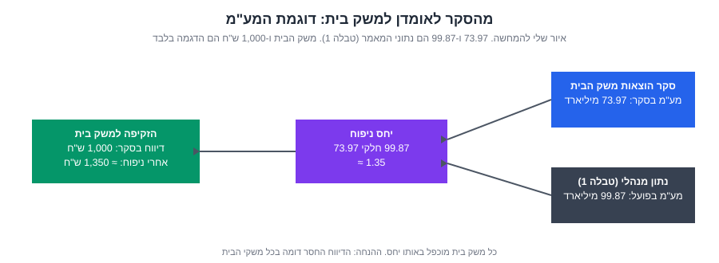
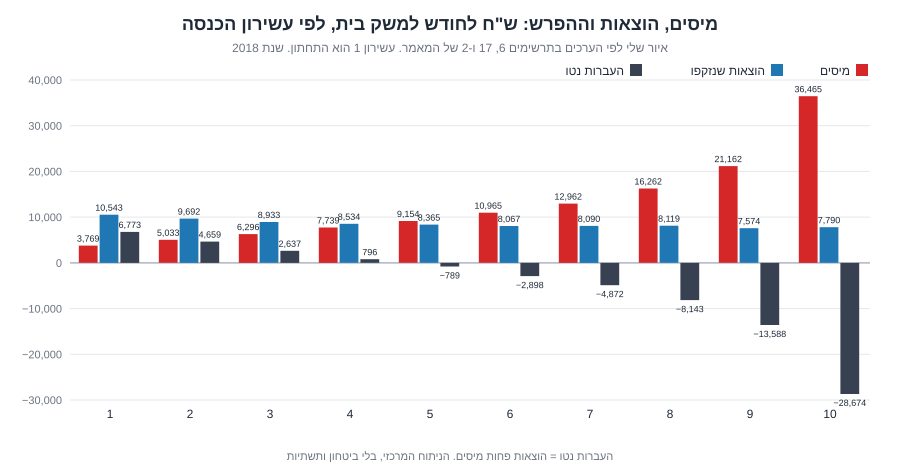
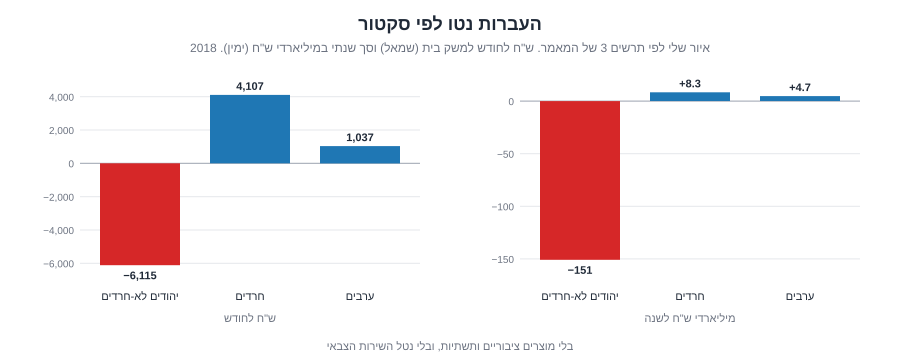
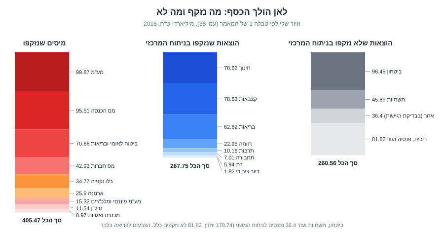
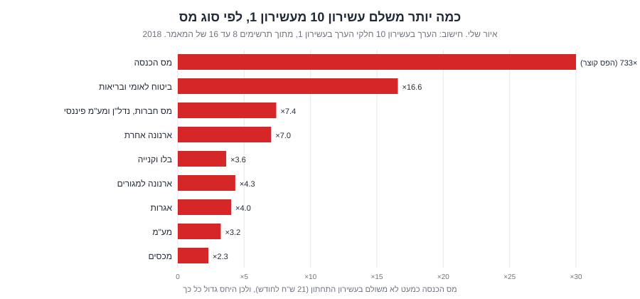
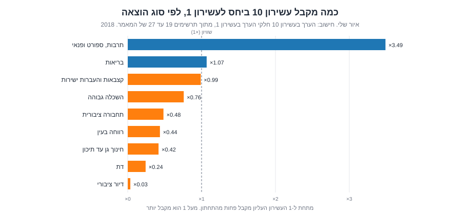
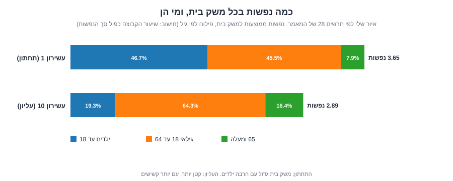
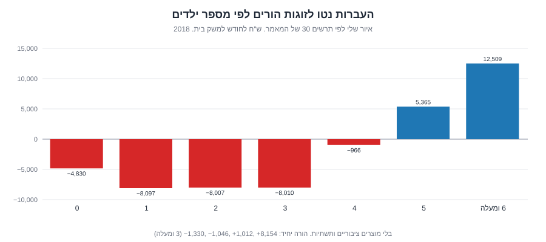
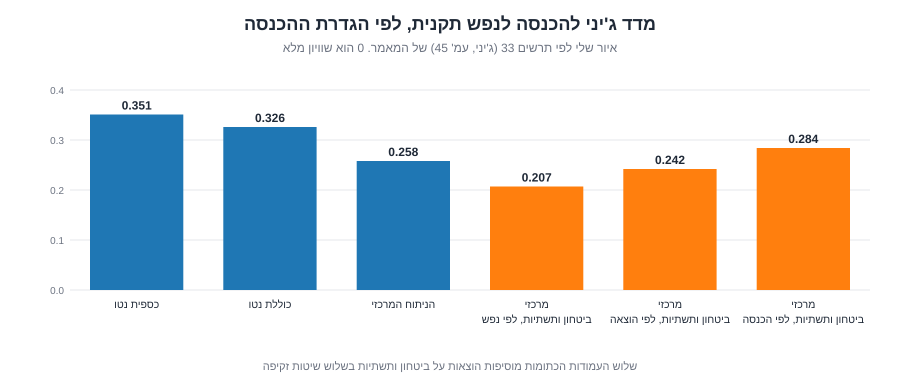

_[English version](/posts/taxes-and-wonders-explainer-en/)_

## 01. למה כתבתי את זה

המאמר "על המיסים ועל הנפלאות" של ארבעה חוקרים מפורום קהלת (אריאל קרלינסקי, תום שדה, ערן יוגב ומיכאל שראל) עושה הרבה רעש. בדרך כלל מצטטים ממנו כמה מספרים בודדים. המאמר עצמו הוא 47 עמודים, 34 תרשימים וטבלה אחת גדולה, ומי שלא קרא אותו לא יודע מה בדיוק נמדד שם.

אז קראתי אותו כולו, תרשים אחר תרשים, ואני מסביר כאן מה כתוב בו. שלושה דברים חוזרים בכל תרשים: מה רואים בו, איך הגיעו למספר, ומה המספר לא אומר.

כמה כללים שקבעתי לעצמי:

- כל מספר מגיע מהמאמר. ליד המספרים המרכזיים מופיע מספר עמוד או תרשים, כדי שאפשר יהיה לבדוק.
- כשחישבתי משהו בעצמי, כתוב "חישוב עצמי".
- איורים שמסומנים "איור שלי" הם ציורים מחדש של ערכים מהמאמר. הם לא התרשימים המקוריים.
- מה שלא הצלחתי לאמת כתוב במפורש, ואני אוסף אותו בסוף בפרק 12.
- פרט שלקחתי מהנספח הטכני מסומן "(נספח)".
- האיורים רחבים. בטלפון לוחצים על איור כדי להגדיל אותו.
- אני לא אומר מה צריכה להיות המדיניות. גם המאמר לא אומר.

> **מה קראתי.** את המאמר הראשי ואת הנספח הטכני (85 עמודים, באנגלית, באתר בנק ישראל). בראש הנספח כתוב שזו גרסת הדפוס של הרבעון לכלכלה מדצמבר 2025. המאמר הראשי שבידי הוא הגרסה שהתקבלה לפרסום ב-24.6.2024. בנספח אני מצטט פרטים ממנו ומסמן אותם "(נספח)". הנספח גם מתאר את התרשימים שלו במילים, ובחלק מהם אין בו מספרים. את מה שלא כתוב במילים לא אמרתי.
{: .prompt-warning }

## 02. השאלה, ודוגמה אחת

מי משלם למדינה, מי מקבל ממנה, וכמה גדול הפער? נשמע פשוט. יש שתי בעיות.

הראשונה: מי ששולח את המס לרשות אינו תמיד מי שנושא בו. הצרכן הטיפוסי מעולם לא ביקר ברשות המסים, אבל הוא משלם מע"מ בכל קנייה, בתוך המחיר.

השנייה: רוב מה שהמדינה נותנת הוא לא כסף. זה בית ספר, קופת חולים, אוטובוס מסובסד. קצבה רואים בחשבון הבנק. משכורת של מורה לא רואים.

המאמר פותר את שתי הבעיות יחד. לכל משק בית הוא זוקף נטל מס ושווי שירותים, ומחסיר.

הדוגמה של המאמר עצמו (עמ' 3): משפחת כהן מקבלת מהמדינה <bdi dir="ltr">2,500</bdi> ש"ח בחודש. משפחה אחרת לא מקבלת תשלום, אבל ילדיה לומדים בבית ספר ציבורי שעולה למדינה <bdi dir="ltr">2,500</bdi> ש"ח בחודש בשכר מורים. מבחינת הקופה הציבורית אין הבדל. מבחינת תלוש יש הבדל גדול. המאמר סופר את שניהם.

## 03. המאמר בכמה שורות

- **שאלות:** אילו מיסים משלמים משקי הבית, מה שווי השירותים וההעברות שהם מקבלים, ומי מקבל יותר משהוא משלם (עמ' 2).
- **נתונים:** סקר הוצאות משק הבית של הלמ"ס, מחובר לנתונים מנהליים כדי להגיע לסכומים של המדינה כולה.
- **היקף:** 405 מיליארד ש"ח מיסים, 268 מיליארד ש"ח הוצאות בניתוח המרכזי. בניתוח משני יש יותר הוצאות. (במונחי 2018.)
- **תוצאה מרכזית (עמ' 2):** משק בית יהודי לא-חרדי ממוצע משלם כ-<bdi dir="ltr">6,000</bdi> ש"ח בחודש יותר ממה שהוא מקבל, וכ-70% ממשקי הבית האלה משלמים יותר ממה שהם מקבלים. משק בית חרדי ממוצע מקבל כ-<bdi dir="ltr">4,000</bdi> ש"ח יותר ממה שהוא משלם, וכ-80% מהם מקבלים יותר. משק בית ערבי ממוצע מקבל כ-<bdi dir="ltr">1,000</bdi> ש"ח יותר, וכ-60% מהם מקבלים יותר.
- **גישה:** פוזיטיבית. המאמר מתאר מה קיים, ואינו קובע אם זה הוגן או רצוי (עמ' 4).

### מילון קצר

הנה המונחים, פעם אחת, כדי שלא נחזור עליהם.

- **ברוטו ונטו** => לפני ואחרי ניכוי מס.
- **משק בית** => מי שגרים יחד ומנהלים כלכלה משותפת. היחידה שבה המאמר סופר.
- **נפש תקנית וסולם שקילות** => אדם נוסף במשק בית לא מוסיף עלות מלאה, כי מחלקים דיור וחשמל. לכן סופרים "נפשות תקניות". המאמר משתמש בשורש הריבועי של מספר הנפשות, כמו ה-OECD. משק בית של 4 הוא 2 נפשות תקניות. משק בית של 9 הוא 3 (חישוב עצמי).
- **עשירון** => עשר קבוצות שוות של משקי בית, מהעני אל העשיר. עשירון 1 הוא התחתון, 10 העליון.
- **נטל מס** => מי שבפועל נושא במס, גם אם מישהו אחר מעביר אותו.
- **עלות חשבונאית** => מה שנרשם בספרים, בלי ההשפעה העקיפה על מחירים ושכר.
- **סקטור** => אחת משלוש קבוצות במאמר: יהודים לא-חרדים, חרדים, ערבים. לפי הנספח, הסקטור הערבי כולל ערבים, בדואים ודרוזים, והצ'רקסים נספרים עם היהודים הלא-חרדים. הסקר כולל בדואים מ-2016 (נספח).
- **שיעור השבה** => אחוז הנדגמים שענו לסקר.
- **העברות נטו** => שווי השירותים וההעברות שמשק בית מקבל, פחות המיסים שהוא נושא בהם. חיובי אומר שמקבל יותר. שלילי אומר שמשלם יותר.

## 04. פרק א': המבוא (עמ' 3 עד 5)

### חבות מול נטל

המחברים פותחים בהבחנה בין מי שהחוק מחייב לבין מי שנושא בנטל. המע"מ מועבר על ידי העסק, והמחיר הגבוה נופל על הצרכן. אולי חלק נופל על היצרן ועל עובדיו, בשכר נמוך יותר. מס חברות מתחלק בין צרכנים, עובדים ובעלי החברה. דמי ביטוח לאומי "על המעסיק" גורמים לעובד לקבל שכר נמוך יותר.

כדי לשייך מס למשק בית, צריך להחליט מי נושא בו. המחברים סקרו ספרות כלכלית כדי להחליט, ונראה את ההחלטות בפרק ג'.

### שירותים לצד כסף

מרבית הוצאות המדינה הן שירותים ולא קצבאות (עמ' 3). לכן משפחה עם חמישה ילדים מקבלת גם קצבאות ילדים וגם חינוך ובריאות. המאמר זוקף את כולם.

הערת שוליים 2 חשובה ומתעלמים ממנה הרבה. שווי הכסף שהמדינה מוציאה על שירות אינו בהכרח שווה את התועלת של משק הבית. אם שירות נכפה עליו, הוא אולי שווה לו פחות. אם יש יתרונות לגודל, הוא אולי שווה לו יותר. המאמר זוקף את העלות, לא את התועלת.

### הפער בספרות

לפי המחברים, מחקרים קודמים כיסו בדרך כלל רק צד אחד: או את ההעברות או את המיסים (עמ' 4). בסיכום (עמ' 46) הם מעריכים שפרסומים קודמים כיסו כ-27% מההכנסות ממיסים וכ-14% מההוצאות. המאמר הזה זוקף כ-96% מהמיסים וכ-50% מההוצאות.

### מה המאמר לא מודד

הוא מודד "מי משלם ומי מקבל". הוא לא קובע אם מערכת המס וההעברות נכונה (עמ' 4).

הוא גם מסביר למה הוא לא בודק פרוגרסיביות, כלומר איזה אחוז מהכנסתו ברוטו משלם כל אחד. ארבע סיבות (עמ' 4):

1. אי אפשר לשפוט מס בנפרד מהשימוש בכספו.
2. הסקר הוא חתך רוחב. הוא צילום של רגע אחד, בלי מעקב אחרי אותם בתים לאורך השנים.
3. שיעור מההכנסה ברוטו מניח שההכנסה ברוטו לא תלויה במדיניות, ואנשים מגיבים לתמריצים.
4. הכנסה ברוטו משקפת גם בחירות תרבותיות בנוגע ללימודים, תעסוקה ופנאי. המחברים מציינים שזה רלוונטי במיוחד בחברה החרדית.

// הטיעון הרביעי הוא החלק הכי שנוי במחלוקת בפרק. הוא נשען על כך שהכנסה נמוכה היא לפעמים העדפה ולא אילוץ. המאמר לא מנסה להוכיח את זה, הוא מציג את זה כנימוק לבחירת השאלה.

מכאן השאלה שהם בוחרים: "מהו היקף ההעברות נטו בין סקטורי האוכלוסייה השונים", ולא "מהו היקף ההעברות בין בעלי הכנסה גבוהה לנמוכה".

## 05. פרק ב': נתונים ותוצאות עיקריות (עמ' 6 עד 12)

### הסקר ולמה 2016 עד 2018

מקור הנתונים הוא סקר הוצאות והכנסות משק הבית של הלמ"ס. משקי בית ממלאים יומן הוצאות לתקופה קצרה, והלמ"ס מחשבת מזה הוצאה חודשית. הוצאות נדירות, כמו קניית רכב, נאמדות בשיטות אחרות.

המחברים איחדו שלושה סקרים, 2016 עד 2018, והתאימו את הערכים ל-2018. התוצאה: <bdi dir="ltr">89,519</bdi> אנשים ב-<bdi dir="ltr">26,664</bdi> משקי בית. עם משקולות הם מייצגים <bdi dir="ltr">8,586,448</bdi> אנשים ו-<bdi dir="ltr">2,603,240</bdi> משקי בית (עמ' 6). המשקולות הן מה שהופך מדגם קטן לתמונה של האוכלוסייה כולה. משק בית שייצג יותר אנשים מקבל משקל גבוה יותר.

עוד כמה פרטים מהנספח. כל משק בית בסקר מנהל יומן הוצאות שבועיים, והלמ"ס מנפחת אותו להוצאה חודשית. הוצאות גדולות, כמו מקרר או רכב, נשאלות בשאלון ומפוזרות על פני חודשים. הסקר מכסה כ-97% ממשקי הבית ואינו כולל קיבוצים שלא עברו הפרטה. בסקר של 2018 לבדו היו 8,792 משקי בית, ולכן אוחדו שלוש שנים. כדי לאחד, הכפילו את המשקולות של 2016 ב-1.045 ושל 2017 ב-1.027, וחילקו ב-3. הסכומים בשקלים הותאמו לפי התוצר הנומינלי לנפש (1.054 ל-2016, 1.029 ל-2017). ההתאמה הזו מתקנת גם מחירים וגם שינויים ריאליים, ולא רק אינפלציה (נספח).

למה לא שנים מאוחרות יותר? המאמר נותן שלוש סיבות (עמ' 6):

- שיעור ההשבה ירד. ב-2016 עד 2018 הוא היה 74.9% עד 75.5%, ב-2019 כ-64%, וב-2020 ו-2021 כ-44.4%.
- ב-2019 הייתה החלפת מתודולוגיה, ולפי הלמ"ס יש "שבר בסדרה". אי אפשר לחבר את השנים הקודמות.
- הקורונה שיבשה את מבנה ההכנסות וההוצאות ב-2020 ו-2021.

### חיבור לסכומים של המדינה

בסקר יש נתונים ישירים רק על מס הכנסה על יחידים, ועל דמי ביטוח לאומי ובריאות של העובד. את השאר המחברים השלימו ממקורות אחרים: חשבונות לאומיים, GFS (מתכונת בינלאומית של סטטיסטיקה פיסקלית), הירחון הסטטיסטי של הביטוח הלאומי, קבצי הרשויות המקומיות ועוד (עמ' 6).

בעיה מוכרת בסקרי הוצאות: אנשים מדווחים פחות ממה שהם מוציאים. לכן סך המע"מ שמחושב מהסקר נמוך מסך המע"מ שהמדינה גבתה. כדי לתקן, המחברים כופלים את הנתון של כל משק בית באותו יחס: הנתון המנהלי חלקי נתון הסקר.

_איור שלי. 73.97 ו-99.87 הם נתוני המאמר (טבלה 1). משק הבית עם <bdi dir="ltr">1,000</bdi> ש"ח הוא הדגמה._

**חישוב עצמי.** 99.87 חלקי 73.97 הוא כ-1.35. משק בית שדיווח בסקר על <bdi dir="ltr">1,000</bdi> ש"ח מע"מ בחודש יזוקף לו כ-<bdi dir="ltr">1,350</bdi>.

הדגמה כזו חושפת את ההנחה: שהדיווח החסר דומה בכל משקי הבית. אם עשירים מדווחים פחות מעניים, הכפלה אחידה לא מתקנת את זה. לא מצאתי בדיקה כזו, לא במאמר ולא בנספח. בנספח יש לפחות חריג אחד: בטבק ובאלכוהול ההפרש חולק לפי מספר המבוגרים, ולא לפי יחס אחיד.

### מבנה ההכנסות (תרשים 1, עמ' 7)

תרשים 1 הוא סכמה, לא גרף. הוא מראה שלושה מקורות הכנסה: מעבודה (שכירה, עצמאית, אחרת), מהון (פנסיה וגמל, ניירות ערך, שכר דירה, וגם "הכנסה זקופה" מדיור בבעלות), ומקצבאות. הסכום הוא **הכנסה כוללת ברוטו**.

מהברוטו מורידים מיסי הכנסה וביטוח לאומי ובריאות של העובד, ומקבלים **הכנסה כוללת נטו**. אם מורידים בנוסף את ההכנסה הזקופה מדיור, מקבלים **הכנסה כספית נטו**.

מהי הכנסה זקופה? מי שגר בדירה שלו לא משלם שכירות. הלמ"ס מחשבת כאילו שילם לעצמו שכירות שוק, כדי שיהיה אפשר להשוות לשוכרים (הערה 3).

המחברים טוענים (עמ' 7 ו-8) שכל ההגדרות האלה מפספסות מיסים כמו מע"מ ומס חברות, ושירותים כמו חינוך ובריאות. לכן הן לא מראות את ההשפעה המלאה של המדינה. הדוגמה שלהם: אילו המדינה העלתה את המע"מ והעבירה את הכסף לחינוך ילדים בעשירון התחתון, המדדים המקובלים לא היו מזהים את השינוי.

### עשירונים, סולם שקילות ויחידת הניתוח

משקי הבית מחולקים לעשירונים לפי **הכנסה כוללת נטו לנפש תקנית** (עמ' 8). ההכנסה הזו משמשת רק לדירוג. עם סולם השקילות של הלמ"ס מתקבלות תוצאות דומות מאוד (הערה 4).

למה משק בית כיחידה? שתי סיבות (עמ' 12). הפעילות הכלכלית מתנהלת ברמת משק הבית, וילדים אינם עובדים. ובסקר אין מעקב אחרי אדם לאורך חייו, ולכן ערבוב שלבי חיים שונים מקשה להסיק על פרטים.

### התוצאות: תרשימים 2 עד 5

**תרשים 2 (עמ' 9). העברות נטו לפי עשירון.** הציר האופקי הוא עשירון. הציר האנכי הוא ש"ח לחודש למשק בית.

הערכים: עשירון 1: <bdi dir="ltr">+6,773</bdi>. עשירון 2: <bdi dir="ltr">+4,659</bdi>. עשירון 3: <bdi dir="ltr">+2,637</bdi>. עשירון 4: <bdi dir="ltr">+796</bdi>. עשירון 5: <bdi dir="ltr">−789</bdi>. עשירון 6: <bdi dir="ltr">−2,898</bdi>. עשירון 7: <bdi dir="ltr">−4,872</bdi>. עשירון 8: <bdi dir="ltr">−8,143</bdi>. עשירון 9: <bdi dir="ltr">−13,588</bdi>. עשירון 10: <bdi dir="ltr">−28,674</bdi>.

אותם ערכים, מפורקים למיסים ולהוצאות:

_איור שלי, מתוך ערכי תרשימים 6, 17 ו-2. העמודות האדומות הן מיסים (תרשים 6), הכחולות הוצאות שנזקפו (תרשים 17), והכהות ההפרש._

| עשירון | מיסים (תרשים 6) | הוצאות (תרשים 17) | העברות נטו (תרשים 2) |
|---|---|---|---|
| 1 | <bdi dir="ltr">3,769</bdi> | <bdi dir="ltr">10,543</bdi> | <bdi dir="ltr">+6,773</bdi> |
| 2 | <bdi dir="ltr">5,033</bdi> | <bdi dir="ltr">9,692</bdi> | <bdi dir="ltr">+4,659</bdi> |
| 3 | <bdi dir="ltr">6,296</bdi> | <bdi dir="ltr">8,933</bdi> | <bdi dir="ltr">+2,637</bdi> |
| 4 | <bdi dir="ltr">7,739</bdi> | <bdi dir="ltr">8,534</bdi> | <bdi dir="ltr">+796</bdi> |
| 5 | <bdi dir="ltr">9,154</bdi> | <bdi dir="ltr">8,365</bdi> | <bdi dir="ltr">−789</bdi> |
| 6 | <bdi dir="ltr">10,965</bdi> | <bdi dir="ltr">8,067</bdi> | <bdi dir="ltr">−2,898</bdi> |
| 7 | <bdi dir="ltr">12,962</bdi> | <bdi dir="ltr">8,090</bdi> | <bdi dir="ltr">−4,872</bdi> |
| 8 | <bdi dir="ltr">16,262</bdi> | <bdi dir="ltr">8,119</bdi> | <bdi dir="ltr">−8,143</bdi> |
| 9 | <bdi dir="ltr">21,162</bdi> | <bdi dir="ltr">7,574</bdi> | <bdi dir="ltr">−13,588</bdi> |
| 10 | <bdi dir="ltr">36,465</bdi> | <bdi dir="ltr">7,790</bdi> | <bdi dir="ltr">−28,674</bdi> |

_ש"ח לחודש למשק בית, 2018. הטבלה היא סידור שלי של ערכי שלושת התרשימים._

ההוצאות כמעט שטוחות, בין <bdi dir="ltr">10,543</bdi> בעשירון 1 ל-<bdi dir="ltr">7,790</bdi> בעשירון 10. המיסים עולים בחדות, מ-<bdi dir="ltr">3,769</bdi> ל-<bdi dir="ltr">36,465</bdi>. תרשים 2 הוא ההפרש בין השניים, עד כדי עיגול.

בדיקה שלי: ממוצע עשרת העמודות בתרשים 2, כפול 12 חודשים, כפול <bdi dir="ltr">2,603,240</bdi> משקי בית, הוא <bdi dir="ltr">−138</bdi> מיליארד ש"ח בקירוב (חישוב עצמי). זה מתאים ל"פער של כ-138 מיליארד" שהמאמר מזכיר (עמ' 8). הוא נוצר כי הניתוח המרכזי זוקף 405 מיליארד מיסים אבל רק 268 מיליארד הוצאות. ההוצאות על ביטחון ותשתיות לא נזקפו.

**מה אין בתרשים:** הוא לא אומר שהעשירון העליון "מממן" את התחתון. הכסף מהמיסים הולך גם להוצאות שלא נזקפו, כמו ביטחון וריבית.

**תרשים 3 (עמ' 10). העברות נטו לפי סקטור.** שני פאנלים: ממוצע למשק בית, וסך שנתי לסקטור.

_איור שלי לפי תרשים 3. בסוגריים במאמר מופיעים גם ערכי 2023: <bdi dir="ltr">−211.7</bdi>, <bdi dir="ltr">+11.6</bdi> ו-<bdi dir="ltr">+6.6</bdi> מיליארד, אחרי התאמה לעליית התוצר הנומינלי (38.5%, הערה 5)._

הממוצעים: יהודים לא-חרדים <bdi dir="ltr">−6,115</bdi>. חרדים <bdi dir="ltr">+4,107</bdi>. ערבים <bdi dir="ltr">+1,037</bdi>. הסכומים השנתיים: <bdi dir="ltr">−150.8</bdi>, <bdi dir="ltr">+8.3</bdi> ו-<bdi dir="ltr">+4.7</bdi> מיליארד ש"ח.

הסכום השנתי תלוי בגודל הסקטור. לכן הסקטור החרדי מקבל סכום כולל קטן (8.3 מיליארד), אף שהממוצע למשק בית גבוה. חישוב עצמי: 8.3 מיליארד חלקי (<bdi dir="ltr">4,107</bdi> כפול 12) הוא כ-168 אלף משקי בית. לערבים יוצאים כ-378 אלף, ליהודים לא-חרדים כ-2.06 מיליון. הסכום, 2.60 מיליון, מתיישב עם <bdi dir="ltr">2,603,240</bdi> משקי הבית במדגם המשוקלל. התרשים לא כולל גם את נטל השירות הצבאי (בהמשך).

**תרשים 4 (עמ' 11). עשירונים בתוך כל סקטור.** שלוש קבוצות של עשר עמודות. העשירונים כאן הם בתוך הסקטור, לא בכלל האוכלוסייה. עשירון 10 של הקבוצה הערבית אינו העשירון העליון הארצי.

- יהודים לא-חרדים (ממוצע <bdi dir="ltr">−6,114</bdi>): עשירון 1 <bdi dir="ltr">+5,472</bdi>. עשירון 4 <bdi dir="ltr">−489</bdi>. עשירון 10 <bdi dir="ltr">−31,286</bdi>.
- חרדים (ממוצע <bdi dir="ltr">+4,137</bdi>): עשירון 1 <bdi dir="ltr">+10,139</bdi>. עשירון 9 <bdi dir="ltr">−560</bdi>. עשירון 10 <bdi dir="ltr">−9,189</bdi>.
- ערבים (ממוצע <bdi dir="ltr">+1,027</bdi>): עשירון 1 <bdi dir="ltr">+8,957</bdi>. עשירון 7 <bdi dir="ltr">−324</bdi>. עשירון 10 <bdi dir="ltr">−12,475</bdi>.

מכאן האחוזים שבתקציר. העברות נטו נעשות שליליות מעשירון 4 אצל יהודים לא-חרדים, מעשירון 7 אצל ערבים, ומעשירון 9 אצל חרדים. לכן כ-30% מהלא-חרדים, כ-60% מהערבים וכ-80% מהחרדים הם מקבלים נטו (עמ' 11).

**תרשים 5 (עמ' 12). כמו תרשים 4, עם מוצרים ציבוריים ותשתיות.** כאן ההוצאה על ביטחון ותשתיות נזקפת לכל משק בית לפי הצריכה שלו. סך ההוצאה הנזקפת 446.48 מיליארד ש"ח, מול 405.47 מיליארד מיסים, כלומר כ-41 מיליארד יותר הוצאות (חישוב עצמי).

הממוצעים לפי הכותרות בתרשים: יהודים לא-חרדים <bdi dir="ltr">−346</bdi>. חרדים <bdi dir="ltr">+10,504</bdi>. ערבים <bdi dir="ltr">+6,211</bdi>.

למה ההוצאה גבוהה מהמיסים כאן? המאמר מסביר (עמ' 11): חלק מהתקציב ממומן בחוב ובהעברות, ולא כל ההכנסות של המדינה הן ממיסים.

עוד פרט חשוב: אין תשובה מוסכמת לשאלה איך לחלק ביטחון בין אזרחים. המאמר בודק שלוש שיטות: לפי נפשות, לפי הכנסה, ולפי צריכה. זקיפה לפי נפשות מצמצמת הכי הרבה את אי-השוויון, לפי הכנסה הכי מעט, ולפי צריכה באמצע. התרשים משתמש בצריכה.

**מה אין בתרשים:** הוא לא מראה מי "נהנה מהצבא". זקיפה לפי צריכה היא הנחה, לא מדידה.

המחברים מציינים (עמ' 12) שחלוקה לעשירונים בשיטה של הלמ"ס או לפי הוצאה נותנת תוצאות דומות. נראה את זה בפרק ה'.

## 06. פרק ג': המיסים (עמ' 13 עד 24)

הסכום הנזקף: 405.47 מיליארד ש"ח, כ-96% מהכנסות המגזר הציבורי הרחב ממיסים (419.11 מיליארד לפי הנתון המנהלי). "המגזר הציבורי הרחב" (General Government) כולל ממשלה, רשויות מקומיות, קופות חולים והמוסד לביטוח לאומי. המאמר מתייחס למיסים נטו, אחרי הטבות מס, כי נתוני הסקר כוללים אותן כבר (עמ' 13).

_איור שלי לפי טבלה 1 (עמ' 38). שורת "ארנונה" מחברת למגורים (11.39) ואחרת (14.51), "בלו וקנייה" מחברת בלו דלק, קניית רכב, טבק ואלכוהול (34.77)._

**תרשים 6 (עמ' 13). סך המיסים לפי עשירון.** ערכים, ש"ח לחודש למשק בית: <bdi dir="ltr">3,769</bdi>; <bdi dir="ltr">5,033</bdi>; <bdi dir="ltr">6,296</bdi>; <bdi dir="ltr">7,739</bdi>; <bdi dir="ltr">9,154</bdi>; <bdi dir="ltr">10,965</bdi>; <bdi dir="ltr">12,962</bdi>; <bdi dir="ltr">16,262</bdi>; <bdi dir="ltr">21,162</bdi>; <bdi dir="ltr">36,465</bdi>.

בדקתי: הממוצע, כפול 12 וכפול <bdi dir="ltr">2,603,240</bdi> משקי בית, הוא כ-405.5 מיליארד (חישוב עצמי). מה אין כאן: זה סכום, לא שיעור מההכנסה, ולכן זה לא מדד פרוגרסיביות.

**תרשים 7 (עמ' 14). מיסים לפי סקטור ועשירון בתוך סקטור.** ממוצעים: יהודים לא-חרדים <bdi dir="ltr">14,050</bdi>. ערבים <bdi dir="ltr">9,044</bdi>. חרדים <bdi dir="ltr">8,799</bdi>. ההבדל בולט בעשירון העליון בתוך כל סקטור (עמ' 13). ערכי העשירון העליון בכל סקטור קטנים מדי בתרשים לקריאה בטוחה, ולכן אני לא מצטט אותם.

### תבנית אחת לכל מס

לכל מס אני מציג את אותו סדר: גודל וחוק, איך הוא מחולק בין נושאים (ההנחה), איך זקפו אותו, ומה בתרשים.

### מס הכנסה על יחידים

**גודל.** כ-96 מיליארד ש"ח, כ-21% מגביית המיסים ב-2018: 91.4 מיליארד מס הכנסה מעבודה ו-4.11 מיליארד מס דיבידנדים ורווחי הון. המס מדורג. שיעורו עולה עם ההכנסה (עמ' 14).

**ההנחה.** הנטל על העובד במלואו. יש ראיות לכך שברמות הכנסה גבוהות חלק מהנטל עובר למעסיק (הערה 7: מעסיק שמנסה לגייס עובדת בשכר גבוה יידרש להעלות את השכר ברוטו). אבל הספרות דלה, ולכן ההנחה נשארה. בבדיקת הרגישות חילקו את המס חצי-חצי בין העובד למעסיק (נספח, ראו פרק 8). המס נשאר פרוגרסיבי, אבל פחות.

**הזקיפה.** הסקר נותן 73.33 מיליארד ש"ח (נספח). המס מופיע בסקר כפריט אחד שכולל גם מס רווחי הון, ואי אפשר להפריד ביניהם. היחס 95.51 חלקי 73.33 הוא כ-1.30, כלומר הזקיפה מעלה את המס של כל משק בית בכ-30%, וההכנסה נשארת כפי שהיא (נספח, חישוב עצמי לפי המספרים). הנתון המנהלי מקבצי "פיסקלי דיגיטלי" של האוצר הוא 95.51. כל משק בית הוכפל ביחס.

**תרשים 8 (עמ' 15).** עשירון 1: 21. עשירון 5: 917. עשירון 9: <bdi dir="ltr">5,883</bdi>. עשירון 10: <bdi dir="ltr">15,403</bdi>. עשירון 10 משלם פי 2.6 מעשירון 9 (חישוב עצמי). התחתונים כמעט לא משלמים כי הם מתחת לסף המס. בכותרת התרשים כתוב שהיחס בין שלושת העשירונים העליונים לשלושת התחתונים הוא 56.2.

הנתון הוא אחרי זיכויים כמו נקודות זיכוי. מה אין בתרשים: מס הכנסה נשען על מי שיש לו הכנסה מעבודה, לא על ההוצאה הכוללת.

### מס ערך מוסף

**גודל.** כ-99 מיליארד, כ-23% מהמיסים. שיעור 17% מ-2015. מוטל על הערך המוסף בכל שלב בשרשרת. מי שצורך בפועל אינו יכול לקזז.

**ההנחה.** הנטל על הצרכן במלואו. המחברים מצטטים כמה מחקרים (Benedek ואחרים, Benzarti ואחרים, Buettner ו-Madzharova).

**הזקיפה.** בנתוני הצריכה של כל משק בית זיהו אילו הוצאות נושאות מע"מ וחישבו מזה. הסקר נותן 73.97 מיליארד. הפער נובע מדיווח חסר, תופעה מוכרת. בהערה 8 המאמר מצטט מחקר בריטי שהכפיל הוצאות כאלה ב-1.4.

**תרשים 9 (עמ' 16).** עשירון 1: <bdi dir="ltr">1,693</bdi>. עשירון 5: <bdi dir="ltr">2,881</bdi>. עשירון 10: <bdi dir="ltr">5,491</bdi>. המע"מ עולה בהדרגה אבל לאט מההכנסה. העליון משלם פי 3.2 מהתחתון (חישוב עצמי). הסבר שלי, שהמאמר לא מפרט: משקי בית עשירים חוסכים חלק מההכנסה ולכן מוציאים פחות ממנה.

### דמי ביטוח לאומי ומס בריאות

**גודל.** כ-70 מיליארד, כ-17% מהמיסים.

**ההנחה.** החלוקה בין "עובד" ל"מעסיק" היא וירטואלית, והשכיר נושא בשני החלקים (עמ' 16 ו-17). המאמר מביא כתימוכין את דנמרק, אוסטרליה וניו-זילנד, שאין בהן הפרדה כזו, ומשווה בין דנמרק לנורבגיה: שם שיעור המס הכולל על שכר ממוצע זהה, אבל בדנמרק הוא רק מס הכנסה ובנורבגיה הוא מתחלק בין שלושה מסים. לבלתי מועסקים, ההנחה שהנטל עליהם.

**הזקיפה.** הסקר: 65.86 מיליארד, כולל חישוב חלק המעסיק. מנהלי: 70.66. הוכפל ביחס.

**תרשים 10 (עמ' 17).** עשירון 1: 377. עשירון 5: <bdi dir="ltr">1,522</bdi>. עשירון 10: <bdi dir="ltr">6,250</bdi>. עליון משלם פי 16.6 מתחתון (חישוב עצמי). התרשים מראה רק את צד התשלום. מה הביטוח הלאומי נותן בתמורה נמצא בצד ההוצאה.

### מס חברות, נדל"ן, מע"מ פיננסי ומע"מ מלכ"רים

**מס חברות.** 23% מרווחי חברות, כ-43 מיליארד, כ-10% מהמיסים. ההנחה: שליש על צרכנים (מחירים גבוהים), שליש על עובדים (שכר נמוך), שליש על בעלי הון (רווחים נמוכים). כל שליש מחולק לפי חלקו של משק הבית בצריכה, בהכנסה מעבודה ובהכנסה מהון בהתאמה. למה שליש? הספרות שהמחברים סקרו נותנת טווחים רחבים: 30% עד 51% מהמס על עובדים, ו-31% עד 60% על צרכנים. ה-CBO האמריקאי מניח 75% על הון ו-25% על עובדים. בניתוח ישראלי קודם (Falk) הניחו שני שליש על הון ושליש על עובדים. המחברים מסכמים: שליש לכל אחד (נספח). בהערה 9 המאמר מציין שזה קירוב: חברות מייצאות משלמות פחות, וחלק מהמס משולם על ידי תושבים זרים. המחברים מניחים שההשפעות האלה מתקזזות.

**המחשה (איור מילולי שלי, המספרים אינם נתונים).** נניח שמס חברות של 300 יחידות נזקף. לפי ההנחה, 100 מהן מחולקות בין משקי הבית לפי הצריכה שלהם, 100 לפי השכר שלהם, ו-100 לפי הכנסות ההון שלהם. משק בית שצורך הרבה, עובד הרבה ומחזיק מעט הון, ישא בעיקר בשני השלישים הראשונים.

**נדל"ן.** מס שבח ומס רכישה: כ-11 מיליארד, כמעט 3% מהמיסים. בסקר זוהו רק כ-1.8 מיליארד, כי כמעט אף משק בית לא דיווח על מס שבח או מס רכישה. שמונה מיליארד מהסכום הם מס שבח (נספח). היתרה חולקה לפי חלקם של משקי הבית בהכנסה מהון, כולל הכנסה זקופה מדירה.

**מע"מ פיננסי ומע"מ מלכ"רים.** מס שכר: 17% מהשכר ברוטו בחברות פיננסיות (כ-3 מיליארד) ו-8.5% במלכ"רים (כ-12 מיליארד). מחולק כמו מס חברות. סך שלושת הסעיפים שנזקפו: 69.79 מיליארד.

**תרשים 11 (עמ' 19).** עשירון 1: 700. עשירון 5: <bdi dir="ltr">1,828</bdi>. עשירון 10: <bdi dir="ltr">5,194</bdi>.

### מיסי קנייה ובלו

**גודל.** כ-35 מיליארד, כ-8%. נזקפו 34.8 מיליארד: בלו על דלק 17.18, מס קניית רכב 10.5, מס טבק 6.13 ומס אלכוהול 0.96. חלק מהמיסים האלה נועד גם להפחית צריכה מזיקה, כמו עישון.

**ההנחה.** בדרך כלל הצרכן נושא במלואו, אבל יש שני חריגים שכדאי להכיר (נספח). בלו על סולר משלמים בעיקר עסקים, ולכן הוא נזקף כמו מס חברות, בשלישים. בבדיקת מס קניית הרכב ההפרש בין הסקר לנתון המנהלי (כ-3 מיליארד) מיוחס לקניות של חברות, והוא מחולק גם כן בשלישים. בלו דלק שמועבר לרשות הפלסטינית (כמעט 3 מיליארד) לא נזקף (הערה 10).

**איך הגיעו לדלק.** כ-37% ממשקי הבית עם רכב לא דיווחו כלל על דלק, אף שלפי הסקר החברתי 94% מהם משתמשים ברכב לפחות פעם בשבוע. לכן אמדו את ההוצאה ברגרסיה ליניארית ממושקלת, לפי מספר המפרנסים, מספר הילדים, סקטור, עשירון ואזור מגורים. ההוצאה הכוללת על דלק עלתה מ-16.31 ל-24.64 מיליארד. מהמחיר לליטר בנזין 95 (6.4 ש"ח, מתוכם 3.04 בלו) חישבו כמה ליטרים נקנו. מס הדלק על בנזין שנמצא כך הוא 12.09 מיליארד, מול 12.43 מיליארד במנהלי.

**טבק ואלכוהול.** בטבק חישבו חפיסות לפי 22 ש"ח מס לחפיסה ומחיר חפיסה של 30 ש"ח ב-2016 (מותאם ל-2018). הסקר נותן 2.8 מיליארד מול 6.13 במנהלי. באלכוהול 0.25 מול 0.96. את ההפרש בשניהם חילקו לפי מספר המבוגרים (18+) בכל משק בית, כי לא ידוע מי מדווח פחות (נספח).

**תרשים 12 (עמ' 20).** עשירון 1: 539. עשירון 5: <bdi dir="ltr">1,013</bdi>. עשירון 10: <bdi dir="ltr">1,965</bdi>. העליון משלם פי 3.6 מהתחתון (חישוב עצמי).

### ארנונה

**גודל.** כ-27 מיליארד, כ-6%: כ-12 למגורים וכ-15 אחרת, בעיקר עסקית. בישראל הארנונה נגבית לפי שטח ולא לפי שווי, ויש הפרדה בין מגורים לעסקים. ארנונת המגורים נמוכה ולא מכסה את עלות השירותים לתושבים. הארנונה העסקית גבוהה מעלות השירותים לעסקים, ולכן היא מסבסדת את התושבים (עמ' 20).

**ההנחה.** ארנונה למגורים: הנטל על משק הבית. ארנונה אחרת: כמו מס חברות, בחלוקה לשלישים.

**תרשים 13 (עמ' 21), ארנונה למגורים.** עשירון 1: 147. עשירון 5: 341. עשירון 10: 637.

**תרשים 14 (עמ' 22), ארנונה אחרת.** עשירון 1: 150. עשירון 5: 383. עשירון 10: <bdi dir="ltr">1,055</bdi>.

בטבלה 1 הזיהוי בסקר של ארנונה למגורים (12.17) גבוה מהנתון המנהלי (11.39), ולכן כאן התיקון הוא כלפי מטה.

### מכסים ואגרות

**מכסים.** כמעט 3 מיליארד (2.79 בתרשים). המאמר זוקף רק את העלות החשבונאית, כי הנטל האמיתי של מכסים (ייקור מוצרים מקומיים, צמצום יבוא) קשה לאמידה. הנספח קורא לזה "קצה הקרחון": מוצר שהמכס עליו גבוה עד שאי אפשר לייבא אותו לא יופיע כלל בחישוב. החלוקה לפי חלק הצריכה של קבוצות מוצרים, ולפי חלקן בגביית המכס: מזון וחקלאות 46.1%, רכב וחלקיו 27.9%, מכשירי חשמל ועץ ונייר 19.8%, והשאר כ-6% (נספח).

**תרשים 15 (עמ' 23).** עשירון 1: 59. עשירון 5: 82. עשירון 10: 136. כמעט אחיד.

**אגרות.** כ-6.2 מיליארד. ההיגיון אומר שאגרה היא תשלום על שירות, ואין צורך לזקוף אותה כמס. אבל הקשר בין האגרה לעלות השירות חלש (אגרת רישיון רכב גבוהה בהרבה מעלות הטיפול). לכן המאמר זוקף את האגרות שזוהו בסקר למשק הבית, ואת היתר, ששילמו עסקים, כמו מס חברות. בסקר זוהו 3.84 מיליארד, מהם 3.51 אגרות רישיון רכב. מול 6.19 במנהלי נשארו כ-2.3 מיליארד, וזה ההפרש שחולק כמו מס חברות (נספח. החיסור הוא חישוב עצמי).

**תרשים 16 (עמ' 24).** עשירון 1: 83. עשירון 5: 187. עשירון 10: 334.

### השוואה בין המיסים

_איור שלי. כל פס הוא הערך בעשירון 10 חלקי הערך בעשירון 1, מתרשימים 8 עד 16._

מס הכנסה וביטוח לאומי עולים בחדות עם ההכנסה. מע"מ, בלו ומכסים עולים לאט. הסיבה: הראשונים נגזרים מההכנסה, והאחרונים מההוצאה, וההוצאה נעה פחות מההכנסה.

**בדיקה שאפשר לעשות לבד.** תרשים 6 הוא סכום תשעת התרשימים האלה, ואפשר לראות את זה. בעשירון 1:

| מס | ש"ח לחודש |
|---|---|
| מס הכנסה | 21 |
| ביטוח לאומי ובריאות | 377 |
| מע"מ | <bdi dir="ltr">1,693</bdi> |
| מס חברות, נדל"ן, מע"מ פיננסי ומלכ"רים | 700 |
| בלו וקנייה | 539 |
| ארנונה למגורים | 147 |
| ארנונה אחרת | 150 |
| מכסים | 59 |
| אגרות | 83 |
| **סך הכל** | **<bdi dir="ltr">3,769</bdi>** |

הסכום מתיישב בדיוק עם הערך בתרשים 6. בעשירון 10 הסכום של <bdi dir="ltr">15,403</bdi>, <bdi dir="ltr">6,250</bdi>, <bdi dir="ltr">5,491</bdi>, <bdi dir="ltr">5,194</bdi>, <bdi dir="ltr">1,965</bdi>, 637, <bdi dir="ltr">1,055</bdi>, 136 ו-334 הוא <bdi dir="ltr">36,465</bdi>, בדיוק (חישוב עצמי). בעשירון 5 מתקבל <bdi dir="ltr">9,154</bdi>, גם בדיוק.

שני הצדדים נראים שונה מאוד. 45% מנטל המס של העשירון התחתון (<bdi dir="ltr">1,693</bdi> מתוך <bdi dir="ltr">3,769</bdi>) הוא מע"מ. אצל העשירון העליון, 42% (<bdi dir="ltr">15,403</bdi> מתוך <bdi dir="ltr">36,465</bdi>) הוא מס הכנסה (חישוב עצמי).

### מה לא נזקף מהצד הזה

הכנסות אחרות של המדינה, כ-62 מיליארד (תשלומי הורים, הלוואות לכיסוי גירעון, סניוראז', מענקים זרים, הכנסות מהון ממשלתי), לא נזקפו. רק סניוראז' הוא סוג של מס, והיקפו זניח (עמ' 24). בנוסף יש 13.63 מיליארד "מיסים נוספים שאינם נכללים" בטבלה 1.

## 07. פרק ד': ההוצאות (עמ' 25 עד 38)

בניתוח המרכזי נזקפו 267.7 מיליארד ש"ח, כ-50.6% מהוצאות המגזר הציבורי הרחב (528.32 מיליארד לפי טבלה 1).

**תרשים 17 (עמ' 25). סך ההוצאות לפי עשירון.** עשירון 1: <bdi dir="ltr">10,543</bdi>. עשירון 2: <bdi dir="ltr">9,692</bdi>. עשירון 5: <bdi dir="ltr">8,365</bdi>. עשירון 9: <bdi dir="ltr">7,574</bdi>. עשירון 10: <bdi dir="ltr">7,790</bdi>. ההוצאות כמעט שטוחות. התחתון מקבל קצת יותר, והמחברים מייחסים את זה בין השאר לגודל משק הבית (נראה בפרק ה').

**תרשים 18 (עמ' 26). לפי סקטור ועשירון.** ממוצעים: חרדים <bdi dir="ltr">12,936</bdi>. ערבים <bdi dir="ltr">10,071</bdi>. יהודים לא-חרדים <bdi dir="ltr">7,936</bdi>. חלק מההבדל נובע מגודל המשפחה ומהרכב הגילים.

### חינוך (גן עד תיכון)

ההוצאה הלאומית הציבורית: 64.48 מיליארד, כ-12% מההוצאות (עמ' 26). זו ההוצאה נטו, בלי ספירה כפולה: אם משרד החינוך מעביר כסף לרשות מקומית, הוא נספר פעם אחת. 2.76 מיליארד ממנה הם "הנהלה כללית", והם חולקו שווה בין כל התלמידים (נספח). הזקיפה לפי גילי הילדים בבית, תוך שימוש בהוצאה לתלמיד לפי שלב (טרום-יסודי, יסודי, חטיבת ביניים, חטיבה עליונה) ולפי סקטור. נלקחה ההוצאה נטו של המגזר הציבורי הרחב, כולל הרשויות המקומיות. הערה 11: ההוצאה לתלמיד חרדי ב-2018 נמוכה מזו של תלמיד יהודי לא-חרדי.

איך חישבו עלות לתלמיד? מנתוני "שקיפות בחינוך" לקחו את התקציב של כל אחד מ-4,966 בתי הספר, חילקו לכיתות ולתלמידים, וסיכמו לפי שלב, סקטור וזרם. בגנים (18,712) התקציב ידוע רק ברמת הרשות, ולכן חילקו אותו לפי הילדים בכל קבוצה. לפעוטות מגיל 0 עד 3 יש מקור נפרד: תשובה לבקשת חופש מידע ממשרד העבודה, לפיה סובסדו 125,442 פעוטות ב-1.12 מיליארד ש"ח.

בסקר הגילים מופיעים בארבע קבוצות (0-4, 5-9, 10-14, 15-17), והמחברים הניחו פיזור אחיד בתוך כל קבוצה. בדקו בחדר המחקר של הלמ"ס שההנחה סבירה (נספח).

**תרשים 19 (עמ' 27).** עשירון 1: <bdi dir="ltr">3,020</bdi>. עשירון 5: <bdi dir="ltr">2,072</bdi>. עשירון 10: <bdi dir="ltr">1,258</bdi>. הסיבה: יש הרבה יותר ילדים בעשירונים התחתונים (תרשים 28, בפרק ה').

### השכלה גבוהה

12.4 מיליארד להשכלה גבוהה, ועוד כ-0.5 להשכלה על-תיכונית לא אקדמית. נזקף לפי הסטודנטים במשק הבית. 12.46 מיליארד הם 11.08 תקציב המל"ג ועוד 1.38 למחקר. מחלקים אותם ל-364,512 סטודנטים בסקר, כלומר כ-2,850 ש"ח לחודש לסטודנט (חישוב עצמי: 12.46 מיליארד חלקי מספר הסטודנטים, חלקי 12).

המחברים מציינים שלא ניתן להבדיל בסקר בין מוסד תקציבי לפרטי, ולכן זו הערכת יתר לסטודנט במוסד פרטי (נספח).

ההשכלה העל-תיכונית הלא אקדמית נזקפת בהסתברות של 74% שהלומד במוסד מתוקצב (נספח).

**תרשים 20 (עמ' 28).** עשירון 1: 554. עשירון 2: 318. עשירון 5: 393. עשירון 10: 420. אין מגמה. העשירון התחתון גבוה כי שם יש סטודנטים צעירים שגרים לבד עם הכנסה נמוכה, אף שהוריהם אולי בעשירון גבוה (עמ' 27). זו דוגמה טובה למגבלה של חתך רוחב.

### בריאות

כ-64 מיליארד, כ-12%. רוב המימון עובר דרך קופות החולים לפי נוסחת הקפיטציה: סכום לכל מבוטח, לפי גיל, מין ומגורים בפריפריה או במרכז. הוא נזקף לפי המשתנים האלה לכל אדם, גם אם לא השתמש בשירות, בגישה "ביטוחית": מה שנחסך לו מרכישת ביטוח או שירות פרטי. נזקפו כ-62 מיליארד. כ-2 מיליארד לתשתיות בריאות נדונים בנפרד.

בפועל: ההוצאה הציבורית ב-2018 הייתה 64.68 מיליארד, ומתוכה הופחתו 1.93 לתשתיות. את השאר חילקו ל-9,448,474 "נפשות סטנדרטיות", כלומר כ-6,627 ש"ח לשנה (552 ש"ח בחודש) לנפש סטנדרטית.

אישה בגיל 85 ומעלה בפריפריה שווה פי 3.5 מילד בגיל 1 עד 5, בלי קשר לשימוש בפועל.

נוסחה אחרת, של אחדות ובן-נון ופוליצר (2016), נותנת תוצאות כמעט זהות (נספח).

**תרשים 21 (עמ' 29).** כל העשירונים סביב <bdi dir="ltr">2,000</bdi> ש"ח: עשירון 1: <bdi dir="ltr">1,949</bdi>. עשירון 2: <bdi dir="ltr">2,134</bdi>. עשירון 10: <bdi dir="ltr">2,084</bdi>. הנוסחה תלויה בעיקר בגיל, ולכן אין הבדל גדול בין עשירונים.

### קצבאות והעברות ישירות

כ-79 מיליארד, כ-15%. קצבאות ביטוח לאומי בסקר: כ-54 מיליארד. העברות ממוסדות אחרים: כ-7. הפער לנתון המנהלי (כ-18 מיליארד) נובע, למשל, מקצבאות סיעוד (בסקר כ-0.8, במנהלי כ-7) ומשירותים בעין של הביטוח הלאומי (כ-12). את השירותים בעין המחברים הפחיתו, ואז התאימו את היתר לסקר. קצבת "חיסכון לכל ילד" (50 ש"ח בחודש) לא בסקר, וחושבה לפי מספר הילדים מתחת ל-18. יוצא 1.6 מיליארד, מול 2.1 במנהלי, כי חלק מהכסף שולם רטרואקטיבית.

לבסוף הכפילו את הקצבאות ביחס 71.44 חלקי 54.89. 71.44 הם 83.89 מיליארד קצבאות מנהליות בניכוי 12.46 שירותים בעין (נספח).

**תרשים 22 (עמ' 30).** עשירון 1: <bdi dir="ltr">2,698</bdi>. עשירון 2: <bdi dir="ltr">2,949</bdi>. עשירון 9: <bdi dir="ltr">2,179</bdi>. עשירון 10: <bdi dir="ltr">2,668</bdi>. כמעט אחיד, עם עלייה בעליון בגלל קצבאות זקנה.

### שירותי רווחה בעין

כ-23 מיליארד, כ-4%. למשל, עובדים סוציאליים.

**תרשים 23 (עמ' 31).** עשירון 1: <bdi dir="ltr">1,304</bdi>. עשירון 2: 825. עשירון 10: 568. יורד לרוב ככל שההכנסה עולה, ולפחות עד עשירון 6 לפי המאמר.

### תחבורה, דיור, תרבות ודת

**תחבורה ציבורית** (7.01 מיליארד, כ-1%). רוב ההוצאה היא סבסוד למפעילי אוטובוסים ולרכבת. בסקר זוהו 4.79 מיליארד, והפער נזקף ביחס. לפי הנספח, הסבסוד לנסיעה באוטובוס הוא 5.81 ש"ח (מעבר ל-2.84 ש"ח שהנוסע משלם), ולנסיעה ברכבת 65 ש"ח (מעבר ל-11.7). מחלקים את ההוצאה של משק הבית בעלות הנסיעה כדי לדעת כמה נסיעות עשה. **תרשים 24 (עמ' 32):** עשירון 1: 294. עשירון 6: 181. עשירון 7: 238. עשירון 10: 142. תנודתי, אבל גבוה יותר בעשירונים נמוכים.

**דיור ציבורי** (1.82 מיליארד, פחות מחצי אחוז). ההטבה העיקרית היא פער שכירות בין דירה ציבורית לשוק, ויש גם הטבת רכישה. לפי הנספח, 1.26 מיליארד הם הטבת שכירות ו-0.55 הטבת רכישה. שכר הדירה "בשוק" נלקח מהשכירות הזקופה של הלמ"ס, ובסקר זוהו 590 משקי בית בדיור ציבורי. **תרשים 25 (עמ' 33):** עשירון 1: 232. עשירון 2: 114. עשירון 5: 68. עשירון 10: 8. עשירון 5 חריג מול 4 ו-6, ולא ברור אם זה אמיתי או רעש.

**ספורט, תרבות ופנאי** (10.16 מיליארד, כ-2%). המוטבים זוהו כך (נספח): חצי מהסכום, 5.08 מיליארד, לפי ההוצאה המדווחת על "מופעי תרבות, ספורט ובידור". החצי השני לפי תדירות היציאה לאירועים בסקר החברתי של 2014, לפי סקטור וחמישון הכנסה. כך נתפסים גם אירועים בחינם. **תרשים 26 (עמ' 34):** עשירון 1: 161. עשירון 5: 297. עשירון 10: 562. זה הסעיף היחיד שבו ההוצאה עולה בבירור עם ההכנסה.

**דת** (5.94 מיליארד לפי GFS, כ-1%). כוללת את המשרד לשירותי דת, מועצות דתיות והוצאות על ישיבות שלא בחינוך. המוטבים זוהו כך (נספח): 1.67 מיליארד לפי הכנסה מ"מוסד מדינה: ישיבה" שמדווחת בסקר. 4.27 מיליארד הנותרים לפי תדירות ביקור בבית תפילה בסקר החברתי של 2009, לפי סקטור ורמת דתיות. **תרשים 27 (עמ' 35):** עשירון 1: 331. עשירון 2: 328. עשירון 5: 182. עשירון 10: 80.

### השוואה בין ההוצאות

_איור שלי. כל פס הוא הערך בעשירון 10 חלקי הערך בעשירון 1, מתרשימים 19 עד 27. הקו המקווקו הוא שוויון._

כמעט כל ההוצאות נוטות לעשירונים נמוכים. היוצאות מן הכלל הן בריאות (בערך שוויון), קצבאות (בערך שוויון, בגלל קצבאות זקנה) ותרבות (גבוה יותר בעליון).

גם כאן אפשר לבדוק שהחלקים מסתכמים. בעשירון 1: חינוך <bdi dir="ltr">3,020</bdi>, השכלה גבוהה 554, בריאות <bdi dir="ltr">1,949</bdi>, קצבאות <bdi dir="ltr">2,698</bdi>, רווחה <bdi dir="ltr">1,304</bdi>, תחבורה 294, דיור 232, תרבות 161 ודת 331. הסכום הוא <bdi dir="ltr">10,543</bdi>, בדיוק כמו תרשים 17. בעשירון 10 הסכום <bdi dir="ltr">7,790</bdi>, גם הוא בדיוק (חישוב עצמי).

### מה לא נזקף ולמה

**ביטחון וביטחון פנים** (כ-96 מיליארד, כ-18%: כ-74 ביטחון וכ-22 ביטחון פנים, לפי הנספח). זה מוצר ציבורי: צריכה של אחד לא מונעת צריכה של אחר, ואי אפשר למנוע מאדם ליהנות ממנו. אין דרך מוסכמת לחלק אותו בין אזרחים. האם לפי נפש, לפי משק בית, לפי הכנסה (כי מי שמרוויח יותר מוגן יותר)? המחברים כותבים ש"התוצאה של כל זקיפה נובעת ישירות מההנחות הנבחרות" (עמ' 35). בנספח נבדקו שלוש שיטות.

**תשתיות** (כ-45 מיליארד, כ-8.7%). הנספח מוסיף נימוק: מחיר החשמל או המים שמשק בית משלם כבר כולל את בניית התשתית, ולכן אפשר לראות בה מכירת שירות ולא העברה. יש בהן היבט של מוצר ציבורי, והן משרתות גם דורות עתידיים, ולכן הן לא נזקפו בניתוח המרכזי (עמ' 36).

**ריבית על החוב** (32.36 מיליארד). החוב נוצר בעבר, ולא ברור איך נכון לזקוף את התשלום בהווה. **פנסיה תקציבית.** חלק ממנה מסווג (למשל גמלאי כוחות הביטחון), ובסקר אי אפשר לזהות מי מקבל. אפשר לראות בה גם חוב עבר. סך ההוצאות שלא נזקפו כלל: 81.82 מיליארד לפי טבלה 1.

עוד כמה סעיפים שהנספח מפרט. כ-36 מיליארד של "שירותים ממשלתיים נוספים" (בנק ישראל, משרד החוץ, הכנסת, סבסוד חקלאות ותעשייה ועוד) מטופלים כמו מוצרים ציבוריים בבדיקות הרגישות. בצד ההכנסות, הנספח מסביר למה לא נזקפו הכנסות מחכירת קרקע (10.58 מיליארד, כי זה תשלום על שירות), הטבות מס (כי הסקר כבר מדווח על מס נטו) וסניוראז' (ב-2018 האינפלציה הייתה 0.8% וריבית בנק ישראל 0.1%, ולכן זניח).

**שירות צבאי.** כאן המאמר נוגע בנקודה עדינה. בגיוס חובה יש "מס חבוי": התשלום למשרתים נמוך מהעלות הכלכלית של השנים האלה, כי הם דוחים לימודים ועבודה. גייבל ושראל (2020) מעריכים את העלות ארוכת הטווח בכ-3.7% מהתוצר, כ-49 מיליארד ב-2018. בסקר אין מידע על שירות צבאי, ולכן אי אפשר לחשב או לחלק אותו. המחברים כותבים שהנטל מוטל בעיקר על יהודים לא-חרדים, ולכן ההעברות נטו השליליות של הסקטור הזה גדולות מהאומדן המרכזי (עמ' 36). ה-49 מיליארד אינם חלק מהחישוב.

## 08. פרק ה': ניתוחים נוספים (עמ' 39 עד 45)

### דמוגרפיה

**תרשים 28 (עמ' 39). מספר נפשות ממוצע לפי עשירון, בפילוח גילים.** עשירון 1: 3.65 נפשות, מהן 46.7% ילדים עד 18, 45.5% בגילים 18 עד 64 ו-7.9% בני 65 ומעלה. עשירון 10: 2.89 נפשות, מהן 19.3% ילדים, 64.3% בגילים 18 עד 64 ו-16.4% בני 65 ומעלה.

_איור שלי לפי תרשים 28. אורך כל קטע הוא האחוז כפול סך הנפשות (חישוב עצמי): 1.70 ילדים בעשירון 1 ו-0.56 בעשירון 10._

זה מסביר חלק מהתרשימים שראינו: חינוך גבוה בתחתון כי יש שם יותר ילדים. בריאות וקצבאות זקנה דווקא גבוהים בעליון, כי יש שם יותר קשישים (נוסחת הקפיטציה נשענת בעיקר על גיל).

**תרשים 29 (עמ' 40). הכנסה נטו לנפש תקנית לפי עשירון, עם גבולות.** כל נקודה היא ממוצע, וקווי השגיאה מראים את גבולות העשירון. החץ בעשירון 10 אומר שהעשירון פתוח כלפי מעלה. אין מספרים מסומנים בתרשים. מקריאת הציר אפשר להעריך כ-<bdi dir="ltr">3,000</bdi> בעשירון 1 וכ-<bdi dir="ltr">28,000</bdi> בעשירון 10. זו הערכה גסה ממני, לא נתון.

### מבנה משק הבית

הניתוח מוגבל להורה יחיד או לזוג הורים עם ילדים מתחת ל-18 (הערה 13). בקרב משקי בית עם הורה יחיד, קבוצות של 3 ילדים ומעלה אוחדו. בקרב זוגות, 6 ילדים ומעלה.

**תרשים 30 (עמ' 41). העברות נטו.**

_איור שלי לפי תרשים 30. הורה יחיד, לפי מספר ילדים 0, 1, 2 ו-3 ומעלה: <bdi dir="ltr">−1,330</bdi>, <bdi dir="ltr">−1,046</bdi>, <bdi dir="ltr">+1,012</bdi>, <bdi dir="ltr">+8,154</bdi>._

זוגות עם 0 עד 3 ילדים משלמים נטו, בין <bdi dir="ltr">4,830</bdi> ל-<bdi dir="ltr">8,097</bdi> ש"ח בחודש. עם חמישה ילדים הם כבר מקבלים נטו, ועם שישה ומעלה הם מקבלים <bdi dir="ltr">12,509</bdi>.

**תרשים 31 (עמ' 42). מיסים.** זוגות, ל-0 עד 6 ומעלה ילדים: <bdi dir="ltr">12,363</bdi>; <bdi dir="ltr">13,858</bdi>; <bdi dir="ltr">16,216</bdi>; <bdi dir="ltr">19,386</bdi>; <bdi dir="ltr">15,314</bdi>; <bdi dir="ltr">11,807</bdi>; <bdi dir="ltr">9,623</bdi>. יחידים (0, 1, 2, 3 ומעלה): <bdi dir="ltr">6,087</bdi>; <bdi dir="ltr">7,229</bdi>; <bdi dir="ltr">8,350</bdi>; <bdi dir="ltr">7,042</bdi>. אצל זוגות המס עולה עד שלושה ילדים ויורד מהילד הרביעי. המאמר מציין את הירידה ולא מסביר אותה.

**תרשים 32 (עמ' 42). העברות המגזר הציבורי.** זוגות: <bdi dir="ltr">7,534</bdi>; <bdi dir="ltr">5,761</bdi>; <bdi dir="ltr">8,210</bdi>; <bdi dir="ltr">11,376</bdi>; <bdi dir="ltr">14,347</bdi>; <bdi dir="ltr">17,172</bdi>; <bdi dir="ltr">22,131</bdi>. יחידים: <bdi dir="ltr">4,757</bdi>; <bdi dir="ltr">6,183</bdi>; <bdi dir="ltr">9,361</bdi>; <bdi dir="ltr">15,196</bdi>. משפחות חד-הוריות מקבלות יותר מזוגות באותו מספר ילדים. המאמר מזכיר שהרבה משקי בית ללא ילדים הם משקי בית של קשישים, שמקבלים יותר בריאות וקצבאות זקנה.

מה אין בתרשימים: הם לא שולטים בגיל, בהכנסה ובסקטור. הם פירוקים, לא הסברים.

### עשירוני הוצאה

לפי תיאוריית ההכנסה הפרמננטית של פרידמן (1957), ההוצאה יציבה יותר מההכנסה לאורך החיים. משקי בית צעירים ומבוגרים נראים עניים בהכנסה הנוכחית, אבל לא בהוצאה. לכן נבדקו גם עשירוני הוצאה (עמ' 43).

**תרשים 33 (עמ' 43). העברות נטו לפי עשירוני הוצאה.** ערכים: <bdi dir="ltr">+6,540</bdi>; <bdi dir="ltr">+3,922</bdi>; <bdi dir="ltr">+1,842</bdi>; <bdi dir="ltr">+212</bdi>; <bdi dir="ltr">−1,958</bdi>; <bdi dir="ltr">−3,876</bdi>; <bdi dir="ltr">−5,990</bdi>; <bdi dir="ltr">−8,333</bdi>; <bdi dir="ltr">−12,320</bdi>; <bdi dir="ltr">−22,143</bdi>. הצורה דומה לתרשים 2. הקצוות נמוכים יותר: <bdi dir="ltr">−22,143</bdi> מול <bdi dir="ltr">−28,674</bdi>.

### מדד ג'יני

ג'יני נע בין 0 (שוויון מלא) ל-1 (כל ההכנסה בידי משק בית אחד). **תרשים הג'יני (עמ' 45)** מראה שש עמודות, כולן על הכנסה לנפש תקנית.

_איור שלי לפי תרשים הג'יני (עמ' 45). שלוש העמודות הכתומות מוסיפות ביטחון ותשתיות בשלוש שיטות זקיפה._

הערכים: הכנסה כספית נטו (כמו בדוח העוני של הביטוח הלאומי) 0.351. הכנסה כוללת נטו 0.326. הניתוח המרכזי 0.258. ועם ביטחון ותשתיות: לפי נפש 0.207, לפי הוצאה 0.242, לפי הכנסה 0.284.

הקריאה של המחברים (עמ' 44): התעלמות מחלק מהמיסים ומחלק מהשירותים מטה כלפי מעלה את אי-השוויון הנמדד. אבל הטווח בין שלוש שיטות הזקיפה (0.207 עד 0.284) מראה כמה ההנחות על מוצרים ציבוריים משפיעות. בשיטת הזקיפה לפי הכנסה המדד הוא 0.284, גבוה מהניתוח המרכזי (0.258) ועדיין נמוך מ-0.326 של הכנסה כוללת נטו.

מה ג'יני אחד לא אומר: איפה בהתפלגות השינוי קורה. לשם צריך את התרשימים לפי עשירון.

### בדיקות רגישות (נספח, פרק 4)

המחברים שאלו: אם ההנחות משתנות, האם התמונה משתנה? הנה מה שכתוב בנספח. הוא מתאר את התוצאות במילים, ולכן אני לא מביא ממנו ערכים מספריים שלא כתובים שם.

**1. מוצרים ציבוריים.** הוסיפו כ-168 מיליארד (לפי הנספח) הוצאות שלא נזקפו (ביטחון, תשתיות ושירותים נוספים) בשלוש שיטות: לפי נפשות, לפי הכנסה ולפי צריכה. התוצאה לפי הנספח:

- ההעברות נטו השליליות עוברות מעשירונים 5 עד 10 לעשירונים 8 עד 10 בלבד.
- לפי נפשות, העשירונים הנמוכים מקבלים יותר והגבוהים משלמים יותר. לפי הכנסה, התמונה מתמתנת. לפי צריכה, מקבלים תוצאה באמצע.
- לפי סקטור, בזקיפה לפי צריכה: בחרדים ובערבים כל העשירונים מקבלים נטו חוץ מהעליון, ובארבעת העשירונים העליונים של היהודים הלא-חרדים משלמים נטו.
- לפי נפשות: בחרדים ובערבים תשעה עשירונים מקבלים נטו, וביהודים הלא-חרדים שישה.
- לפי הכנסה: כמו בצריכה, חוץ מעשירון עליון חרדי שמקבל מעט נטו.

ההוצאות אחרי הזקיפה עולות על המיסים בכ-30 מיליארד, כי יש הכנסות מדינה שלא נזקפו (מכירת קרקע, דיבידנדים) וגירעון.

**2. השוואת הוצאות להכנסות.** הכפילו את ההוצאות של כל משק בית ביחס שמשווה את סך ההוצאות לסך המיסים. אז רק חמשת העשירונים העליונים של היהודים הלא-חרדים משלמים נטו. בחרדים רק העשירון העליון, ובערבים שני העליונים.

**3. הנחות נטל המס.** שלוש בדיקות, כל אחת משנה הנחה אחת:

| המס | ההנחה המרכזית | ההנחה בבדיקה | מה השתנה |
|---|---|---|---|
| מע"מ ומיסי קנייה | הצרכן במלואו | שליש צרכן, שליש עובד, שליש הון | עשירונים 7 עד 10 משלמים יותר, 1 עד 6 פחות |
| מס הכנסה והון | העובד במלואו | חצי עובד, חצי מעסיק | פחות פרוגרסיבי, עדיין פרוגרסיבי |
| מס חברות | שלישים | הון בלבד | כמעט ללא שינוי |

בכל שלוש הבדיקות, ובשלושתן יחד, התמונה הכללית נשארת: עשירונים 1 עד 4 מקבלים יותר משהם משלמים, ועשירונים 5 עד 10 משלמים יותר.

**למה זה יציב?** הנספח עונה: הכנסה מעבודה, צריכה והכנסה מהון קשורות מאוד זו לזו. במתאם פירסון בין עשירונים: עבודה וצריכה 0.95, עבודה והון 0.98, צריכה והון 0.89. משק בית עם הכנסה גבוהה מעבודה בדרך כלל גם צורך הרבה ומחזיק הרבה הון. לכן כשמעבירים נטל ממס אחד לאחר, הסכום ששילם משק הבית משתנה מעט (נספח, טבלה 5).

**4. הגדרת העשירונים.** הם בדקו חלוקה לפי הגדרת הלמ"ס: הכנסה כספית נטו לנפש תקנית לפי סולם ישראלי. רוב המעברים הם בין חמישונים סמוכים, והתוצאות דומות מאוד.

**5. מיסים שמטרתם לתקן נזק.** מיסי דלק, טבק, אלכוהול ורכב נועדו גם לתמחר נזק לאחרים, כמו פקקים ועישון. כשמפחיתים אותם, הנטל יורד בכל העשירונים. הם 13% מהמיסים בעשירון התחתון ו-3.5% בעליון (נספח).

**מה הבדיקות לא אומרות.** הן לא בודקות הנחות שונות לגמרי, כמו הנחה שמס ההכנסה נופל כולו על המעסיק. הן בודקות כל אחת בנפרד ואחר כך יחד, בטווח שהמחברים בחרו.

### נטל המס כאחוז מההכנסה (נספח, פרק 5)

המחברים לא רצו למדוד פרוגרסיביות, והסבירו למה בפרק א' (ארבע הסיבות למעלה). בכל זאת הם חישבו, כדי להראות שהתוצאה לא נעלמת. הם חילקו את המיסים ואת השירותים בהכנסה הכלכלית ברוטו (עבודה והון, בלי קצבאות). לפי הנספח:

- השירותים וההעברות שווים 387% מההכנסה הכלכלית בעשירון התחתון ו-29% בעליון.
- המיסים מגיעים ל-107% מההכנסה בתחתון, ולמינימום של 55% בעשירון 7.
- אחוז של מעל 100% נראה מוזר. הנספח נותן שני הסברים: משקי בית אלה צורכים ממה שקיבלו או חסכו, והמיסים והשירותים הותאמו לחשבונות הלאומיים בעוד ההכנסה לא. דוגמה: מס ההכנסה גדל ב-30% בהתאמה, וההכנסה נשארת.

## 09. פרק ו': דיון וסיכום (עמ' 46 ו-47)

**תרומות (עמ' 46):** אפשר לדון באופן מבוסס בהיקף ובאופן שבו המגזר הציבורי מחלק מחדש הכנסות, בלי להתעלם משירותים. והמחקר יכול לשמש בסיס להשוואה בין מדינות, כי הוא לא מוטה בגלל הרכב שונה של מערכת המס בכל מדינה.

**היקף:** כ-96% מהמיסים וכ-50% מההוצאות, לעומת 27% ו-14% בפרסומים קודמים.

**ממצאים עיקריים:**

- משקי בית בעשירונים נמוכים מקבלים העברות נטו חיוביות. הם מקבלים בממוצע יותר שירותים והעברות מהגבוהים, חוץ מקצבת זקנה.
- חרדים וערבים מקבלים יותר שירותים והעברות ממה שהם משלמים במיסים, במידה ניכרת.
- מבנה משק הבית ומספר הילדים משפיעים הרבה.

**סימולציות.** הנתונים מאפשרים לבדוק, למשל, איך ישפיע שינוי בהיקף הבריאות הציבורית על הכנסת משקי הבית בעשירונים שונים, או מי ישא בעלות של דרכי מימון שונות. אבל סימולציות כאלה בדרך כלל מניחות שאין שינוי התנהגות, ולכן יש לפרש אותן בזהירות (עמ' 46 ו-47).

**מגבלות.** המאמר מציין כמה, בפרקים שונים: חתך רוחב, דיווח חסר, מוצרים ציבוריים, הנחות נטל, וחוסר התייחסות לשירות צבאי. אין בו פרק מגבלות. הרשימה בפרק 11 למטה היא הסידור שלי.

**מה אפשר להסיק ומה לא.** אפשר לבחון הצעות מדיניות מול ההעברות נטו הקיימות (עמ' 47). אי אפשר להסיק שמדיניות מסוימת צודקת או לא, וגם לא שהממוצע תקף לכל משק בית בקבוצה.

## 10. הנספח הטכני וטבלה 1

הנספח הוא קובץ נפרד. במאמר שבידי הקישור אליו הוא מקום שמור (XXX ו-YYY, עמ' 1), ומצאתי אותו באתר בנק ישראל. חמשת פרקיו: נתונים, שיטות הזקיפה לכל מס והוצאה, מה לא נזקף, בדיקות רגישות ופרוגרסיביות. הפרטים שלו כבר שולבו בפרקים למעלה.

הטבלה שכדאי להכיר היא **טבלה 1 (עמ' 38)**. לכל שורה יש ארבע עמודות: הנתון המנהלי (מה שהמדינה רשמה), הזיהוי בסקר (מה שנמצא בסקר), הזקיפה בפועל (מה שנזקף למשקי הבית אחרי ההתאמה), והזקיפה כאחוז מהנתון המנהלי.

| פריט | מנהלי | סקר | נזקף |
|---|---|---|---|
| הכנסות ממיסים | 419.11 | 324.03 | 405.47 (96.74%) |
| מס הכנסה על יחידים | 95.51 | 73.33 | 95.51 |
| ביטוח לאומי ובריאות | 70.66 | 65.86 | 70.66 |
| מע"מ | 99.87 | 73.97 | 99.87 |
| מע"מ פיננסי ומלכ"רים | 15.32 | 15.32 | 15.32 |
| מס חברות | 42.93 | 42.93 | 42.93 |
| מיסי נדל"ן | 11.54 | 1.89 | 11.54 |
| בלו על דלק | 17.18 | 11.12 | 17.18 |
| מס קניית רכב | 10.5 | 7.61 | 10.5 |
| מס טבק | 6.13 | 2.82 | 6.13 |
| מס אלכוהול | 0.96 | 0.28 | 0.96 |
| מכסים ואגרות | 8.98 | 6.62 | 8.97 |
| ארנונה למגורים | 11.39 | 12.17 | 11.39 |
| ארנונה אחרת | 14.51 | 14.51 | 14.51 |
| מיסים שלא נכללו | 13.63 | | |

_מיליארדי ש"ח, 2018. מטבלה 1, חוץ מהזיהוי בסקר של מס הכנסה, שלקחתי מהנספח._

הוצאות, מאותה טבלה: חינוך 78.62, בריאות 62.62, קצבאות 78.63 (בסקר 60.46), רווחה בעין 22.95, תחבורה 7.01 (בסקר 4.79), דיור ציבורי 1.82, תרבות 10.16 ודת 5.94. סך הכל 267.76. אחרי זה: ביטחון 96.45, תשתיות 45.89 וסעיפים נוספים שנבדקו ברגישות, שיחד עם הנזקפות מגיעים ל-446.50.

בדקתי את החיבורים (חישוב עצמי):

- שורות המיסים הנזקפים מסתכמות ל-405.47, בדיוק.
- 405.47 ועוד 13.63 הם כ-419.11, ההכנסה המנהלית.
- סעיפי ההוצאה בניתוח המרכזי מסתכמים ב-267.76.
- 267.76 ועוד 178.74 הם 446.50. ההוצאות בניתוח המשני עולות אפוא על המיסים בכ-41 מיליארד, כמו בתרשים 5.
- 267.76 ועוד 178.74 ועוד 81.82 הם 528.32, סך ההוצאות המנהלי.

בשתי שורות אין מה לנפח: מס חברות וארנונה אחרת זוהו בסקר במלואם. בארנונה למגורים התיקון הפוך, כי הסקר גבוה מהנתון המנהלי (12.17 מול 11.39), ולכן היא יורדת בכ-6% (חישוב עצמי).

## 11. איך לקרוא את המאמר בביקורתיות

מה ספקן סביר יטען, ומה המאמר עושה בעניין:

| טענה | מה המאמר עושה | מה נשאר פתוח |
|---|---|---|
| הנחות נטל המס שרירותיות | סקירת ספרות ומבחני רגישות (בנספח) | התוצאות בנספח ובפרק 8: התמונה הכללית נשמרת |
| ניפוח לפי יחס אחיד מניח דיווח חסר אחיד | מקורות מנהליים לכל סעיף | אין בדיקה שהחסר זהה בכל משקי הבית |
| מוצרים ציבוריים: הזקיפה קובעת את התוצאה | שלוש שיטות, והמחברים מודים שהתוצאה "נובעת מההנחות" | אין תשובה אחת |
| חתך רוחב מערבב שלבי חיים | עשירוני הוצאה וניתוח לפי מבנה משפחה | אין מעקב אחרי אותם בתים לאורך זמן |
| יחידת הניתוח היא משק בית, לא נפש | נימוק מפורש בעמ' 12 | משקי בית שונים בגודלם בין סקטורים. נתוני גודל לפי סקטור לא בגוף המאמר |
| שירות צבאי ומס חבוי | דיון מילולי ואומדן חיצוני | לא נזקף. אין מספר בטבלה |
| שווי שירות אינו שווה לעלותו | הערה 2 | הערך של השירות למשק בית לא ידוע |
| נתוני 2018 | נימוקים להעדפה | אין בדיקה מול שנים מאוחרות |
| אין תגובה התנהגותית | המחברים מצהירים על כך | סימולציות דורשות זהירות |

כמה דברים לשמור בראש:

- "העברות נטו" הוא הפרש בין מס שנזקף לשירות שנזקף, בלי הוצאות שלא נזקפו, ועם הנחות. הוא לא "תרומה" ולא "חוב".
- שני משקי בית באותו עשירון יכולים להיות בשלבי חיים שונים. הממוצע אינו משפחה טיפוסית.
- סכום שנתי לסקטור תלוי בגודל הסקטור. ממוצע למשק בית תלוי בגודל המשפחה.
- המאמר פוזיטיבי. מי שמסיק ממנו מסקנה נורמטיבית מוסיף הנחה משלו.

## 12. מקורות ראשוניים: מה הם

אלה המקורות שהמאמר נשען עליהם, ומה כל אחד:

- **סקר הוצאות משק הבית (הלמ"ס).** סקר שנתי של אלפי משקי בית שממלאים יומן הוצאות. מקור ההכנסות וההוצאות ברמת משק הבית.
- **חשבונות לאומיים (הלמ"ס).** סיכום הכלכלה כולה: הוצאה לאומית לחינוך ולבריאות, השקעות והון.
- **GFS (Government Finance Statistics).** מסגרת בינלאומית לדיווח הכנסות והוצאות הממשלה הרחבה. המאמר משתמש בה להוצאה על דת ועוד.
- **הירחון הסטטיסטי של הביטוח הלאומי.** קצבאות ודמי ביטוח.
- **"פיסקלי דיגיטלי" (משרד האוצר).** קבצי הכנסות מס הכנסה ומע"מ.
- **דוח הכנסות המדינה ורשות המסים.** נתוני גבייה לפי מס.

### מה לא נבדק

- ערכי העשירון העליון בתרשים 7, ותרשים 29 שאין בו מספרים.
- האם הקפיצה בדיור ציבורי בעשירון 5 (תרשים 25) אמיתית.
- הערכים המספריים של תרשימי הנספח. הנספח מתאר אותם במילים, ואני כתבתי רק מה שנאמר במילים.
- הנספח הוא גרסת הדפוס מדצמבר 2025, והמאמר הראשי שבידי הוא הגרסה שהתקבלה לפרסום ב-2024. ייתכן שיש הבדלים קטנים ביניהם שלא איתרתי.

## 13. מקורות

Karlinsky, A., Sadeh, T., Yogev, E., & Sarel, M. (2024). *על המיסים ועל הנפלאות: התפלגות הכנסות והוצאות המדינה בקרב משקי הבית בישראל* [מאמר שהתקבל לפרסום ב"רבעון לכלכלה", 24.6.2024]. פורום קהלת לכלכלה. https://z.calcalist.co.il/assets/pickerul/6b90f139-7ff2-4976-af70-01940ab73a94.pdf

הלשכה המרכזית לסטטיסטיקה. (2023). *סקר הוצאות משק הבית*. https://www.cbs.gov.il/he/Surveys/Pages/סקר-הוצאות-משקי-בית.aspx

Manski, C., & Mayshar, J. (2000). Child allowances and fertility in Israel: Preliminary findings. *The Economic Quarterly*, 47(4), 535-565. http://www.jstor.org/stable/23772985

Friedman, M. (1957). The permanent income hypothesis. In *A theory of the consumption function* (pp. 20-37). Princeton University Press. http://www.nber.org/chapters/c4405

גייבל, ג', ושראל, מ'. (2020). *עלויות כלכליות של שירות החובה בישראל*. פורום קהלת לכלכלה.

נספח טכני: *Appendix: On Taxes and Wonders* (גרסת הדפוס של הרבעון לכלכלה, דצמבר 2025). בנק ישראל. https://boi.org.il/media/ysmh4ykd/appendix.pdf

המקורות האחרים שבהם המאמר משתמש מופיעים ברשימת המקורות שלו (עמ' 48 עד 58).
